<!-- hero:start (generated by scripts/render_profile.py; edit data/profile.yml) -->

  <a href="https://github.com/SanjayJoshi116"></a>

<!-- hero:end -->

## About

- **Software developer at [Agrileaf](https://agrileaf.in)**: I build full-stack business apps with React and Django. Before that, I built real-time computer vision for agriculture and industrial inspection (YOLO11), and Raspberry Pi systems that drive actuators and sensors.
- **Now building**: SwingTrade AI, an NSE swing screener with 23 setup detectors, regime detection and a backtester; and Contribution Finder, which matches a developer's GitHub skills to open-source issues and explains each match.
- **Off the clock**: I shoot photos and edit them in Lightroom, and I watch movies, web series and anime.

## Featured

<!-- featured:start (generated by scripts/render_profile.py; edit data/profile.yml) -->
**Shipped in public**

<a href="https://github.com/SanjayJoshi116/movie-app-v2">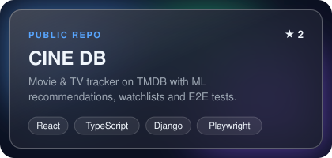</a>
<a href="https://github.com/SanjayJoshi116/movie-dash-v2">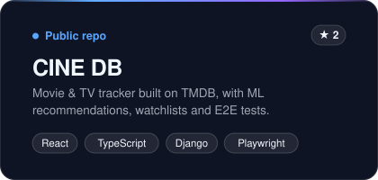</a>

**Building in private**

<a href="#all-projects">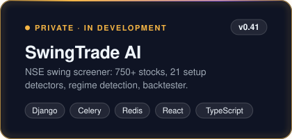</a>
<a href="#all-projects">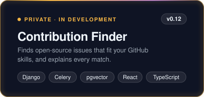</a>

<!-- featured:end -->

<!-- pulse:start (generated by scripts/render_profile.py; edit data/profile.yml) -->

  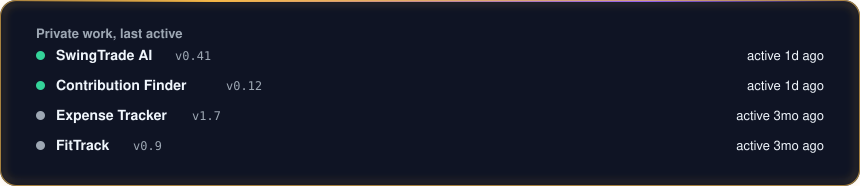

<!-- pulse:end -->

<!-- diagram:start (generated by scripts/render_profile.py; edit data/profile.yml) -->

<b>How SwingTrade AI works</b>

  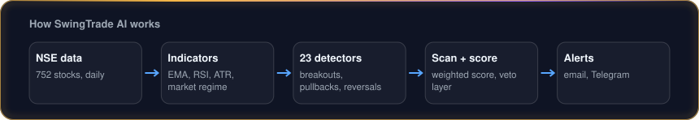

<!-- diagram:end -->

<!-- projects:start (generated by scripts/render_profile.py; edit data/profile.yml) -->

<b>All projects</b> (9 private · 8 public)

#### Private, in development

- **SwingTrade AI** (v0.41): NSE swing-trade screener with 23 setup detectors, regime detection, risk-based sizing, alerts and a 24-strategy backtester. *Django · Celery · Redis · React · TypeScript*
- **Contribution Finder** (v0.12): matches a developer's GitHub skills to open-source repos and issues, with an evidence-backed reason for every pick. *Django 5 · DRF · Celery · pgvector · React 19 · TypeScript*
- **Expense Tracker** (v1.7): self-hosted personal finance app covering budgets, debts, investments and net worth, with 20+ planning tools. *React 19 · Django 6 · Celery · PostgreSQL*
- **FitTrack** (v0.9): fitness tracker with a 1,500+ movement library, workout plans, session logging and progress stats. *Django 6 · React 19 · TypeScript*
- **Swing-Trade Research** (v0.39): walk-forward research on systematic NSE portfolio strategies, using cost-aware LightGBM models. *Python · Django · Pandas · LightGBM · PyTorch*
- **NSE Signal Bot & Backtester** (w/ [@Tilak004](https://github.com/Tilak004)): Pine Script signals, a 10-year Python backtester and a daily NSE alert bot. *Python · Pandas · Pine Script · Streamlit*
- **Gym Management**: two-portal gym management app covering members, plans, trainers, attendance and payments. *Django 5 · DRF · React 19 · PostgreSQL*
- **Chore App**: tracks and assigns office chores. *Node.js · Express · React 19 · SQLite*
- **Blog Platform**: personal blog with a draft-and-publish workflow. *Django 6 · SQLite*

#### Public repos

| Project | Stack | What it is |
|---------|-------|------------|
| [movie-app-v2](https://github.com/SanjayJoshi116/movie-app-v2) (CINE DB) | React · TypeScript · Django · PostgreSQL · Playwright | Movie & TV tracker built on TMDB, with ML recommendations and E2E tests |
| [movie-dash-v2](https://github.com/SanjayJoshi116/movie-dash-v2) | React 19 · TypeScript · Vite · Chart.js | Movie analytics dashboard with a hardened Express API |
| [tv-dash](https://github.com/SanjayJoshi116/tv-dash) | React · TypeScript · Vite · Recharts | Personal watch-history dashboard with 14 charts |
| **Early ML coursework** [StartupSuccessPrediction](https://github.com/SanjayJoshi116/StartupSuccessPrediction) · [HousePricePrediction](https://github.com/SanjayJoshi116/HousePricePrediction) · [CricketScore](https://github.com/SanjayJoshi116/CricketScore) · [CustomerSegmentation](https://github.com/SanjayJoshi116/CustomerSegmentation) · [MachineLearningPrograms](https://github.com/SanjayJoshi116/MachineLearningPrograms) | Python · scikit-learn · Jupyter | Regression, clustering and score-prediction notebooks |

<!-- projects:end -->

## Stack

<!-- stack:start (generated by scripts/render_profile.py; edit data/profile.yml) -->

  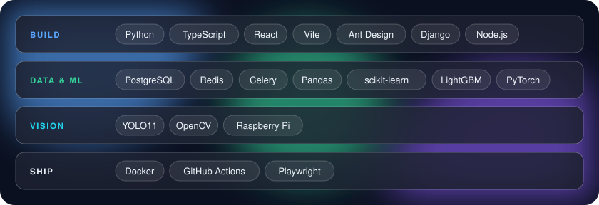

<!-- stack:end -->

## Activity

<!-- activity:start (generated by scripts/render_profile.py; edit data/profile.yml) -->

  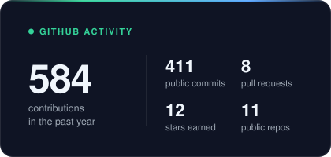
  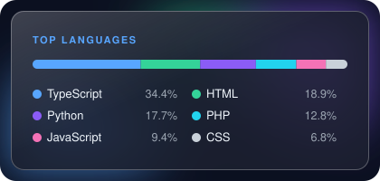

<!-- activity:end -->

## Connect

<!-- connect:start (generated by scripts/render_profile.py; edit data/profile.yml) -->

  
  <a href="https://instagram.com/s_a_n_j_a_y_j_o_s_h_i_">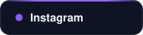</a>
  

<!-- connect:end -->
